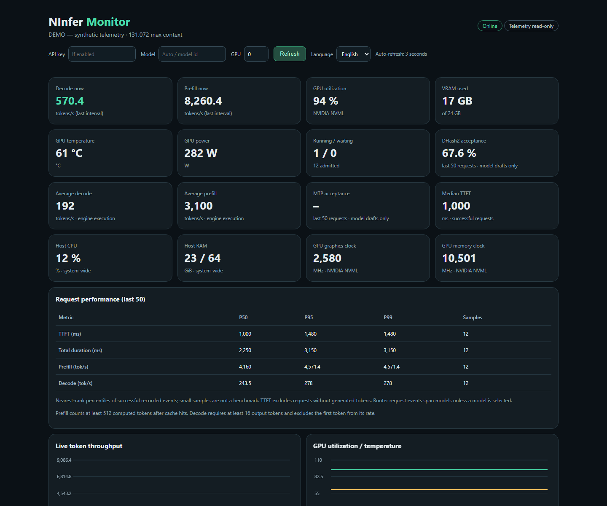

# Built-in NInfer Monitor

The native dashboard is compiled into every ninfer-serve build, including
Windows builds without NINFER_WEBUI_DIR. No separate Python process, downloaded
assets, CDN or external web service is needed.

## Dashboard preview

The screenshot uses the actual v0.1.8 native dashboard with synthetic demonstration data,
not production telemetry or benchmark measurements.
[Mobile view (390 px)](images/monitor/monitor-mobile.png) ·
[English overview](https://spk-c.github.io/ninfer-all-rtx4090/monitor.html) ·
[Deutsche Übersicht](https://spk-c.github.io/ninfer-all-rtx4090/monitor-de.html).

The new screenshots use an isolated synthetic telemetry fixture and no production model or prompt data. Telemetry remains read-only; optional test chat sends requests explicitly.

## Open

With the default HTTP port, open **http://127.0.0.1:8080/monitor**.
If you started NInfer with `--port 8081`, open **http://127.0.0.1:8081/monitor**
instead. The dashboard always polls the server at the same origin.

The page polls GET /stats, GET /metrics, GET /monitor/requests and optional
GET /monitor/gpu and GET /monitor/system once every three seconds. It shows a time-windowed decode/prefill rate (differences of
monotonic token counters), active/waiting requests, device KV occupancy,
draft acceptance, uptime, aggregate activity and the last 50 request events. In router mode,
enter the exact model ID in the Model input to inspect a particular model.

The request table reports P50, P95 and P99 for TTFT, total duration, prefill rate
and decode rate over successful events in the current ring. Prefill divides
computed prompt tokens (total minus cache hits) by prefill time and requires
at least 512 computed tokens. Decode requires at least 16 output tokens and
divides the output count after the first token by decode time. Each row shows
its sample count. Live interval rates and engine-lifetime averages are separate
from these per-request statistics. Exports and optional local history include the numeric
rate percentiles and sample counts from each dashboard poll.

## NVIDIA GPU sensors

GET /monitor/gpu?index=0 provides optional NVML readings, including
GPU utilization, temperature, power, VRAM used and capacity. Choose an index
from 0 through 7 in the UI. NVML is loaded dynamically; no NVIDIA import
library, SDK or new build-time dependency is required. Unsupported or
unavailable sensors are displayed as a dash, not substituted with fabricated
numbers. This index is the NVIDIA NVML index; if the model is on a
different GPU, select that index explicitly.

On Linux, the build links CMAKE_DL_LIBS for the dynamic loader. On Windows,
it loads nvml.dll at runtime. Queries use the driver management API and do
not access the inference CUDA context.

## Authentication and privacy

- GET /monitor and /monitor/ are public **static HTML documents**, like
  optional WebUI assets. No model statistics, secrets or prompts are embedded.
- GET /stats, GET /metrics, GET /monitor/gpu, GET /monitor/system and GET /monitor/requests retain normal API-key
  authentication. With `--api-key` configured, enter it into the page's
  password field. The value stays in tab memory and is not written to
  localStorage, cookies or URL query parameters.
- The HTML response uses a restrictive Content-Security-Policy; data is
  fetched only from the page's own origin.
- Keep `--host 127.0.0.1` for local-only access, unless remote access
  was intentionally configured.

## Measurement limitations

- Decode/prefill rates are differences of **server-wide completed/committed
  token counters** over the most recent polling interval. The first reading
  has no prior sample, so rates start with an empty value.
- The DFlash2 card aggregates model-draft acceptance from the last 50
  request events whose speculative backend is DFlash2. N-gram proposals
  are excluded. It is not a per-token instantaneous rate, and displays
  a dash until matching completed requests exist. MTP has a separate card with the same model-draft-only calculation.
- KV occupancy is not the total submitted chat context length.
- The recent-requests table is a bounded in-memory server feed (last 50
  completed, rejected or failed requests), with timestamps, status, token counts,
  cached tokens, speculative backend and timing. It contains **no prompts,
  completions or token IDs**.
  The separate activity table remains successive aggregate samples.
- The live chart keeps 120 samples in the tab; polling pauses while hidden.
  Optional saved numeric history is bounded to 500 samples in localStorage for
  this browser origin. It is off by default and survives server restarts, not a
  server-side durable log. Clearing/disabling removes the saved history.
- JSON/CSV export contains only an allowlist of numeric fields, never request
  text, model names, API keys or chat messages. Saved history can mix workloads
  across restarts; it is not a continuous benchmark.

For full per-request JSONL logs, CPU/RAM, sensor overrides and
longer history, the existing **tools/monitor/monitor.py** sidecar remains
available; see tools/monitor/README.md.

## Additional telemetry and test chat (development)

Average prefill and decode use the existing Prometheus execution-time rates
(`llamacpp:prompt_tokens_seconds`, `llamacpp:predicted_tokens_seconds`), not
wall-clock serving throughput. TTFT and total latency use nearest-rank P50/P95/P99
from successful events in the bounded 50-event buffer; sample counts are shown.
TTFT excludes zero-output requests and non-positive durations. In router mode
select an exact model ID to filter events. No sample means no value.

`GET /monitor/system` reports system-wide CPU utilization (counter delta, first
sample unavailable) and physical RAM used/total via Windows system APIs or Linux
/proc. Optional NVML graphics and memory clocks are in /monitor/gpu; failed or
unsupported sensors return null. CPU/RAM do not represent inference-process usage.

The language selector supports English and German. The separate test chat sends
an explicit non-streaming OpenAI-compatible POST to /v1/chat/completions, with
normal API authentication. It runs real inference, unlike the read-only telemetry.
Chat retains up to 20 messages in tab memory; no automatic sending or chat
persistence. Clear chat or change model/key to reset. Cancel aborts the client
request; server-side work may continue until cancellation is observed. Avoid
private prompts if independent server logging is enabled. No public project site
connects to a local server. The public demo uses synthetic fixture data only.
