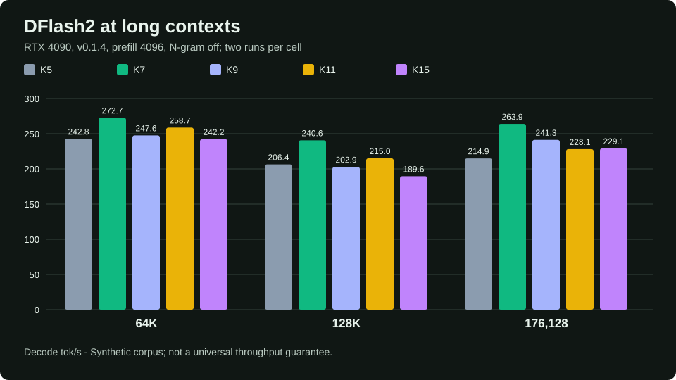

# RTX 4090 v0.1.4: controlled draft, prefill and long-context tuning (2026-11-26)

AI-assisted benchmark execution and documentation. The exact published Windows SM89 release is
`rtx4090-v0.1.4+a6b1138` (NVCC 13.4.92, runtime/driver report CUDA 13.5). One RTX 4090, 24 GB,
450 W power limit; Huihui Qwen3.8-27B GSQ-RCO IQ3_S Vision DFlash2 artifact.
Model and binary SHA-256 are in the manifests. Both campaigns use the same hashes.
No upstream or other-engine comparison is claimed.

**143 completed measurements:** 78 Engine runs (48 + 30), 49 nonstreaming API requests
(33 + 16), and 16 streaming API requests (eight overlapping pairs). No infrastructure
errors were reported. The separate final launcher smoke is not included in 143.
Two reverse-order runs per Engine cell, 512 measured decode tokens, repeated pinned
65,536-token corpus, N-gram disabled for Engine screens; not a statistical guarantee.
Engine prompt lengths are context minus 1,024; the fixed corpus is not a production workload.
GPU telemetry is relative to each campaign's first sample. Two repetitions cannot remove
clock, temperature or desktop-load variance.

## 32K fixed vs adaptive DFlash2 (prefill 1024)

| Width | Fixed decode tok/s | Adaptive decode tok/s |
|---:|---:|---:|
| 5 | 257.11 | 243.71 |
| 7 | 293.96 | 287.19 |
| 9 | 267.79 | 270.84 |
| 11 | 304.22 | 299.79 |
| 15 | 313.16 | 298.03 |

K15 wins this 32K screen only. The long-context screen below reverses that ranking.

## Prefill screen, 32K, fixed K15

| Chunk | Native prefill tok/s | cuBLAS prefill tok/s |
|---:|---:|---:|
| 1024 | 3357.63 | 3355.63 |
| 2048 | 3320.47 | 3326.72 |
| 4096 | 3476.06 | 3490.29 |

4096 native is the selected chunk. cuBLAS has a small numerical quality tradeoff; three
short coding-copy outputs matched the expected results, but this is not a perplexity or
general quality test. Leave cuBLAS off.

## Long-context DFlash2 sweep (prefill 4096, fixed width, no copy)

| Width | 64K decode | 128K decode | 176128 decode |
|---:|---:|---:|---:|
| 5 | 242.75 | 206.39 | 214.87 |
| 7 | 272.74 | 240.60 | 263.93 |
| 9 | 247.57 | 202.86 | 241.25 |
| 11 | 258.70 | 215.03 | 228.06 |
| 15 | 242.20 | 189.58 | 229.13 |



K7 wins decode at all three depths. Versus K5 with the same chunk, improvements are
12.35%%, 16.57%%, and 22.83%%. This is decode, not end-to-end cold-prompt speedup;
64K and 176K cold total time in this screen was slightly lower with K5.
At 176128 the K7 two runs were 259.23 and 268.64 tok/s. No claim about all prompts,
sampling settings or reasoning workloads follows from this fixture.

## Graphs, calibration and cache

| 32K graph mode | Decode tok/s |
|---|---:|
| default | 301.91 |
| buckets | 312.65 |
| draft | 299.60 |
| target | 311.51 |

Flat draft and target prepared 10 and 42 sites respectively, with zero reported fallbacks.
At 176128, attention buckets off/on produced identical 512 token IDs on all four
requests and approximately 274.63/274.83 tok/s. No material advantage: keep all
experimental graph switches off. Local calibration was slower than built-in on the
two-request cold 32K server comparison (523.93 vs 553.46 decode tok/s); keep built-in.
Concurrency 1 vs 2 was similar for two cold requests; retain 2 for interactive agents.

The first campaign's 176K hybrid cache case used K15/4096, N-gram 15,
175,104 input tokens and 128 output tokens. Cold/repeated/continued wall times
were 72.680 / 0.441 / 0.399 seconds. Repetition reused 175,103 prompt tokens
(164.8x cold-to-repeat wall-time ratio); continuation reused 175,231 tokens.
These are warm-prefix latency measurements, not general inference speedups.
The baseline K5/1024 and K15/4096 produced identical text hashes in these cases.
The second campaign tested K7 at 176K with cache disabled for bucket isolation.

See the [coding and overlap report](rtx4090-v014-coding-2026-11-26.md) and
the opt-in [K7 launch configuration](../../configs/rtx4090-huihui-dflash2-k7.ini).
No global defaults or engine code are changed. The portable INI/PowerShell launcher was separately smoke-tested on the exact release with a correct READY response (public-preset-smoke.json).

## Evidence and reproduction

- [First campaign](../../profiles/bench/rtx4090-v014-tuning-20261126/): manifest, 48 individual sanitized Engine JSON reports, per-run CSV/JSON, 33 API metrics, calibrated profile, GPU trace.
- [Second campaign](../../profiles/bench/rtx4090-v014-long-coding-20261126/): 30 Engine reports, ranking, 16 API metrics, four bucket runs, eight overlap pairs, GPU trace and final launcher smoke.
- [Benchmark tools](../../scripts/benchmark-v014-tuning.py) and [long-context runner](../../scripts/benchmark-v014-long-coding.py) are portable-path adaptations of the scripts used on the test host. They have been syntax/CLI checked; the complete adapted campaigns have not been rerun. The default version guard requires the measured v0.1.4 binary; for later releases explicitly add `--allow-other-build` to both commands.
- [Reference evidence validator and regression comparison](../../scripts/check-v014-benchmark.py) runs without a GPU for integrity checks; comparison with a new run requires real matching hardware and comparable conditions.

On Windows, with Python 3.10+, Git, NVIDIA driver, the exact portable archive and model:

```powershell
python scripts/benchmark-v014-tuning.py --bin-dir C:/ninfer-release --model C:/models/huihui.ninfer --out C:/bench/run1
python scripts/benchmark-v014-long-coding.py --bin-dir C:/ninfer-release --model C:/models/huihui.ninfer --previous C:/bench/run1 --out C:/bench/run2
python scripts/check-v014-benchmark.py --candidate C:/bench/run2 --tolerance 0.10
```

The public corpus is constructed by repeating the repository's `bench/fixtures/bench_corpus.ids`
to 176128 tokens with single spaces and CRLF, matching the recorded SHA-256.
Use empty output directories; stop other GPU inference first. The runner refuses
to launch if an existing NInfer process is detected. Local raw response bodies,
request logs, admin tokens, absolute paths and process identifiers are intentionally
excluded from the public evidence; numerical per-run metrics and output hashes remain.
